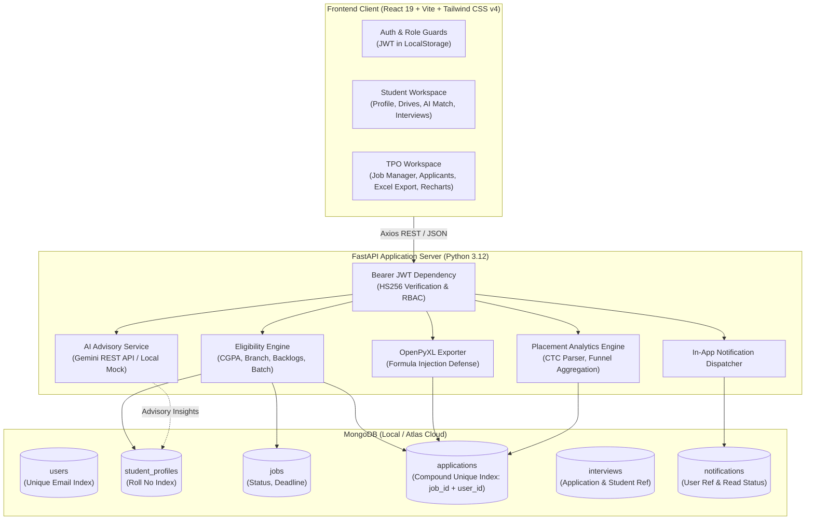

# AI-Assisted College Placement & Training Management Portal
## B.Tech Computer Science & Engineering — Semester 7 Major Academic Project Dossier

---

### Table of Contents
1. [Project Overview & Problem Statement](#1-project-overview--problem-statement)
2. [End-to-End System Architecture](#2-end-to-end-system-architecture)
3. [Database Schema Dictionary & Indexing Strategy](#3-database-schema-dictionary--indexing-strategy)
4. [Core Architectural Decisions & Security Defenses](#4-core-architectural-decisions--security-defenses)
5. [Live Project Demonstration Script (Viva Walkthrough)](#5-live-project-demonstration-script-viva-walkthrough)
6. [Top 20 Academic Viva Questions & Model Examiner Answers](#6-top-20-academic-viva-questions--model-examiner-answers)
7. [Production Deployment Guide](#7-production-deployment-guide)

---

### 1. Project Overview & Problem Statement

#### 1.1 The Institutional Challenge
In traditional higher education institutions, Training and Placement Offices (TPOs) manage campus recruitment through fragmented, error-prone manual channels:
- **Scattered Data:** Student academic records, resumes, and contact details are repeatedly collected via Google Forms and WhatsApp spreadsheets.
- **Manual Eligibility Checking:** Placement officers manually verify hundreds of student CGPAs, 10th/12th percentages, department branches, and backlog counts against varying corporate criteria.
- **Lack of Auditability:** Disputed shortlists, lost applications, and lack of historical records when students alter their profile details after applying.
- **Excel Vulnerabilities:** Reliance on unvalidated CSV downloads susceptible to formula injection attacks.

#### 1.2 The Engineered Solution
A secure, modern, full-stack platform providing:
1. **Deterministic Rule-Based Eligibility Engine:** Server-enforced verification guaranteeing that zero ineligible students can apply.
2. **Immutable Application Snapshots:** Every submitted application freezes the candidate's academic and resume state at application time.
3. **Genuine Microsoft Excel (`.xlsx`) Export Engine:** Built with `openpyxl`, styled headers, auto-fit columns, and formula injection sanitization.
4. **Consultative Advisory AI:** Powered by Google Gemini 1.5 Flash (with automatic deterministic regex/skill-dictionary offline mock fallback) for resume analysis, skill-gap detection, and interview readiness recommendations.
5. **Interactive Recharts Telemetry:** Live department placement charts, recruitment funnel conversion analysis, and corporate leaderboard.

---

### 2. End-to-End System Architecture



---

### 3. Database Schema Dictionary & Indexing Strategy

#### 3.1 Collections & Critical Indexes

| Collection | Key Fields | Indexes & Constraints | Purpose |
| :--- | :--- | :--- | :--- |
| `users` | `email`, `hashed_password`, `role`, `full_name`, `is_active` | `email` (Unique, Ascending) | Authentication & RBAC credentials (`student`, `tpo_admin`, `tpo_staff`) |
| `student_profiles` | `user_id`, `roll_number`, `department`, `cgpa`, `active_backlogs`, `resume_text` | `user_id` (Unique), `roll_number` (Sparse Unique) | Comprehensive academic and professional profile |
| `jobs` | `company_name`, `title`, `required_branches`, `min_cgpa`, `max_active_backlogs`, `deadline`, `status` | `status` (Ascending), `created_at` (Descending) | Campus placement drives and eligibility parameters |
| `applications` | `job_id`, `student_id`, `user_id`, `status`, `student_snapshot`, `status_history` | `(job_id, user_id)` (Compound Unique) | Recruitment submissions; enforces strictly 1 application per student per job |
| `interviews` | `application_id`, `job_id`, `student_id`, `round_type`, `scheduled_time`, `status` | `student_id` (Ascending), `scheduled_time` (Ascending) | Video & campus interview scheduling and outcome tracking |
| `notifications` | `user_id`, `title`, `message`, `type`, `is_read`, `created_at` | `user_id` (Ascending), `created_at` (Descending) | User notification inbox with unread counter |

---

### 4. Core Architectural Decisions & Security Defenses

#### 4.1 Strict Separation: Deterministic Eligibility vs. Advisory AI
- **Institutional Principle:** Under academic regulations, artificial intelligence **must never** reject students or make authoritative hiring selections.
- **Implementation:** Eligibility verification is 100% deterministic mathematical code (`backend/app/services/eligibility_service.py`).
  - Criteria verified: `Branch in required_branches`, `CGPA >= min_cgpa`, `Active Backlogs <= max_active_backlogs`, `Graduation Year == batch_year`.
  - The AI service (`gemini-1.5-flash`) functions strictly as an advisory mentor: calculating skill overlap, highlighting missing competencies, and recommending resume enhancements.

#### 4.2 Formula Injection Defense in Excel (`openpyxl`) Exports
- **The Threat (CWE-1236):** If an applicant enters their name or project as `=CMD|'/C calc'!A0` or `@SUM(...)`, spreadsheet software (Microsoft Excel / LibreOffice) evaluates that cell as an executable formula upon opening.
- **The Defense (`backend/app/services/excel_service.py`):**
  Every exported text cell is passed through a sanitization filter:
  ```python
  if isinstance(val, str) and val.startswith(('=', '+', '-', '@', '\t', '\r')):
      return "'" + val  # Neutralizes formula execution by treating cell as literal text
  ```

#### 4.3 Immutable Historical Application Snapshots
- When a student updates their CGPA or skills in their profile, historical applications must remain unaffected.
- At the instant of application creation, the backend copies the student's complete academic metrics into an embedded `student_snapshot` document inside the application record.

#### 4.4 Password Security & Cryptography
- Passwords are salted and hashed using `bcrypt` (work factor 12). Plaintext passwords are never logged or persisted.
- API requests are authenticated using cryptographically signed JSON Web Tokens (JWT) using the `HS256` HMAC algorithm with expiration timestamps.

---

### 5. Live Project Demonstration Script (Viva Walkthrough)

To present this project seamlessly to academic evaluators, execute the following 8-step flow:

1. **Step 1: Student Registration & Profile Setup**
   - Register a student account (`teststudent@college.edu`).
   - Populate CGPA (`8.45`), Department (`CSE`), Passing Batch (`2026`), and Backlogs (`0`).
   - Upload a sample PDF resume: Observe live text parsing via `pypdf`.

2. **Step 2: Advisory AI Resume Optimization**
   - Click **"Analyze with Advisory AI"**: Notice extracted skills, placement readiness feedback, and 1-click `+ Add to My Skills` action.

3. **Step 3: TPO Placement Drive Creation**
   - Log into TPO Portal using administrator credentials (`admin@tpo.college.edu` / `Admin@12345`).
   - Create a Drive: e.g., *Google Cloud SWE Intern*, Min CGPA: `8.0`, Branches: `["CSE", "IT"]`, Backlogs: `0`, Package: `18 LPA`.
   - Publish the drive.

4. **Step 4: Rule-Based Eligibility Engine Verification**
   - Switch to the student account and visit **Placement Drives**.
   - Review the detailed eligibility badge: `"Eligible: All academic criteria satisfied"`.
   - Open another drive with Min CGPA `9.0`: Observe deterministic explanation: `"Ineligible: CGPA 8.45 is below minimum 9.00"`.
   - Click **"AI Match"** to view skill gap analysis and tailored interview preparation roadmap.

5. **Step 5: Application Submission & Duplicate Prevention**
   - Apply to the eligible Google drive.
   - Attempt to click apply a second time: Notice immediate block enforced by compound unique database index `(job_id, user_id)`.

6. **Step 6: TPO Applicant Pipeline & Stage Transitions**
   - As TPO, open **Applicants** for the Google drive.
   - Filter applicants by Branch, CGPA, and Status.
   - Transition applicant from `Applied` $\rightarrow$ `Shortlisted`.

7. **Step 7: Interview Scheduling & In-App Notification Center**
   - Schedule an interview round with date, time, and Google Meet link.
   - Switch to student view: Observe the bell icon badge increment with an instant notification and view the interview round in **My Interviews**.

8. **Step 8: Genuine Excel Export & Recharts Analytics Dashboard**
   - In TPO Portal, click **"Export to Excel (.xlsx)"**: Download authentic workbook with styled headers and formula sanitization.
   - View **TPO Dashboard**: Present the Recharts Department Bar Chart, Recruitment Funnel progression, and CTC metrics.

---

### 6. Top 20 Academic Viva Questions & Model Examiner Answers

#### Q1. Why did you choose FastAPI over traditional Django or Flask?
**Answer:** FastAPI was selected because of its high asynchronous I/O performance (built on Starlette and Uvicorn), native integration with Pydantic for automated request/response schema validation, automatic OpenAPI/Swagger documentation generation, and native Python 3.12 type hinting support. For a modern RESTful microservice handling concurrent PDF parsing and AI API requests, FastAPI provides superior speed and lower latency compared to synchronous WSGI frameworks.

#### Q2. Why did you use MongoDB instead of a relational database like PostgreSQL or MySQL?
**Answer:** MongoDB’s flexible BSON document model allows us to store immutable **application snapshots** naturally as embedded sub-documents without requiring complex multi-table joins. Furthermore, student profiles have variable-length arrays of skills, certifications, and projects that map cleanly to document schemas. We maintain relational integrity where it counts through database-level unique indexes (e.g., compound index on `job_id` and `user_id` preventing duplicate applications).

#### Q3. How do you prevent duplicate job applications?
**Answer:** Duplicate applications are prevented at two layers:
1. **Application Layer:** Before processing an application, the service checks if an existing document matches `job_id` and `user_id`.
2. **Database Constraint Layer:** A compound unique index on `{ "job_id": 1, "user_id": 1 }` is created at database initialization. If concurrent requests race past the application layer, MongoDB raises a `DuplicateKeyError` (error code 11000), which FastAPI catches and translates into an HTTP 409 Conflict.

#### Q4. What is Formula Injection (CSV/Excel Injection), and how does your application mitigate it?
**Answer:** Formula Injection (CWE-1236) occurs when untrusted user input (such as student names, project titles, or phone numbers starting with `=`, `+`, `-`, or `@`) is written directly into spreadsheet cells. When a placement officer opens the exported file, spreadsheet software treats the cell as a dynamic formula and executes it. Our `excel_service.py` inspects every cell string and prepends a single quotation mark (`'`) to any value starting with `=`, `+`, `-`, `@`, `\t`, or `\r`. This forces Excel to treat the entry strictly as a literal text string.

#### Q5. How does your system ensure AI does not unfairly reject students?
**Answer:** In our architecture, AI has zero authority over admissions, shortlisting, or rejection. All eligibility verification is performed by a deterministic rule engine (`eligibility_service.py`) written in pure Python logic comparing student CGPAs, active backlogs, passing batches, and branches directly against TPO parameters. The Google Gemini LLM is used strictly in an advisory capacity: it generates skill-gap analyses, suggests resume improvements, and generates project ideas to help students prepare.

#### Q6. What happens if the Google Gemini API quota is exceeded or the server has no internet connection?
**Answer:** The AI module implements a defensive fallback architecture. When `AI_PROVIDER=mock`, or if the external API call to Gemini times out or returns an error (HTTP 429 / 500), the system catches the exception and immediately invokes a deterministic local mock engine. This fallback uses regex and a dictionary of technical keywords to provide accurate skill extraction and match scores without crashing the system or blocking the user.

#### Q7. How is Role-Based Access Control (RBAC) enforced?
**Answer:** RBAC is enforced on the backend through FastAPI dependency injection (`app.api.deps.require_role`). Each route specifies allowed roles (e.g., `["tpo_admin"]` for posting jobs and exporting spreadsheets; `["student"]` for applying). The dependency extracts the user identity from the decoded JWT payload, queries their current active status in MongoDB, and validates that their assigned role belongs to the authorized whitelist, returning HTTP 403 Forbidden if unauthorized.

#### Q8. Why did you embed the student profile snapshot inside the application document?
**Answer:** Academic applications represent a historical legal record. If a student has a CGPA of 8.2 when applying to a company in August, but updates their profile to 7.8 in December after a semester result, the company’s recruitment team must see the exact qualifications the candidate possessed at the moment of submission. Embedding an immutable snapshot prevents historical records from mutating.

#### Q9. How do you handle password storage securely?
**Answer:** We use `bcrypt` via the `passlib` library with salt rounds (cost factor 12). When a user registers, their plaintext password is salted and hashed before persistence. During login, `bcrypt.verify` computes the hash of the entered password against the stored salt and hash. Plaintext passwords are never saved to disk or transmitted in responses.

#### Q10. What is JWT and how does session invalidation work?
**Answer:** JSON Web Tokens (JWT) are cryptographically signed, stateless authentication tokens composed of three base64url-encoded parts: Header, Payload, and Signature. The signature is created using HMAC-SHA256 (`HS256`) with a server secret key (`JWT_SECRET_KEY`). Tokens include an expiration timestamp (`exp`). For immediate account deactivation, our dependency checks the `is_active` boolean field on the user document on every protected request.

#### Q11. How does the PDF resume parser work?
**Answer:** When a student uploads a `.pdf` file via the multipart form upload endpoint, the backend validates the file extension and magic byte header, writes the binary stream to disk under `backend/uploads/resumes/`, and parses the text pages using `pypdf.PdfReader`. Extracted text is sanitized and stored in the database so that both the student and the advisory AI service can analyze competencies without re-reading the PDF on every request.

#### Q12. What chart types are used in your Recharts placement dashboard and why?
**Answer:**
1. **Grouped Bar Chart:** Compares total registered students versus placed students across engineering branches (CSE, IT, ECE, MECH, etc.).
2. **Area / Funnel Chart:** Visualizes recruitment pipeline drop-off across stages (`Applied` $\rightarrow$ `Shortlisted` $\rightarrow$ `Assessment` $\rightarrow$ `Interview` $\rightarrow$ `Selected`).
3. **Donut / Pie Chart:** Displays the percentage distribution of application statuses.

#### Q13. How does your backend calculate CTC metrics (Highest, Average, Median)?
**Answer:** The analytics service implements a regex-based CTC parser that handles diverse institutional salary formats (e.g., `"12 LPA"`, `"8.5 LPA"`, `"₹10,00,000"`, `"1400000"`). It normalizes all packages to Lakhs Per Annum (LPA), computes the maximum for highest CTC, arithmetic mean for average CTC, and uses Python's `statistics.median` for median package.

#### Q14. How does the in-app notification center work?
**Answer:** When a TPO officer schedules an interview or transitions an applicant's stage (e.g., to Shortlisted or Selected), an automated trigger creates a document in the `notifications` collection with the recipient's `user_id`. The frontend's `NotificationBell` component displays unread badge counts and allows students to mark notifications as read individually or all at once.

#### Q15. What is Pydantic V2 and why did you use `model_config = ConfigDict(from_attributes=True)`?
**Answer:** Pydantic V2 is written in Rust for high-performance data parsing and validation. In Pydantic V2, the legacy inner `class Config` was deprecated in favor of `ConfigDict`. `from_attributes=True` allows Pydantic models to extract data directly from Python objects and dictionaries, ensuring strict typing and schema safety.

#### Q16. How did you structure testing in this project?
**Answer:** We wrote an automated test suite using `pytest` and `pytest-asyncio` with 49 comprehensive unit and integration tests across:
- `test_auth.py`: User registration, duplicate emails, login, and token generation.
- `test_student_profile.py`: Profile updates and PDF resume upload.
- `test_jobs.py`: Drive creation, eligibility rule evaluation, and status updates.
- `test_applications.py`: Application pipeline, duplicate prevention, and stage changes.
- `test_exports.py`: Excel workbook generation, column verification, and formula sanitization.
- `test_interviews_and_notifications.py`: Scheduling and notification dispatches.
- `test_ai.py`: Gemini REST queries and deterministic mock fallback.
- `test_analytics.py`: CTC parsing, funnel telemetry, and RBAC security.

#### Q17. How do you prevent Cross-Origin Resource Sharing (CORS) errors in production?
**Answer:** We configure FastAPI's `CORSMiddleware` using an environment variable (`CORS_ORIGINS`). In development, it permits `http://localhost:5173`. In production, it whitelists the exact deployed Vercel domain while rejecting unauthorized cross-origin requests.

#### Q18. How does the frontend handle SPA routing on Vercel?
**Answer:** In Single-Page Applications (SPAs) built with React Router, all routes (`/student/profile`, `/tpo/jobs`, etc.) are resolved by client-side JavaScript. When a user directly visits or refreshes a sub-route on Vercel, the web server would return a 404 error without a rewrite rule. We solved this by adding `frontend/vercel.json` with a rewrite rule routing all paths to `/index.html`.

#### Q19. What is the difference between TPO Administrator and TPO Staff roles?
**Answer:** The system supports multi-tier administrative permissions:
- **`tpo_admin` (Super Admin):** Has authority to post/archive drives, review audit logs, export reports, and manage staff accounts.
- **`tpo_staff`:** Has operational access to review applicants, schedule interview rounds, and record interview results, but cannot create super-administrators or alter global institutional configurations.

#### Q20. What are the future enhancements for this portal?
**Answer:**
1. **Automated Calendar Integration:** Syncing scheduled interview dates with Google Calendar / Outlook via OAuth2.
2. **WhatsApp Notification Webhooks:** Sending instant SMS/WhatsApp alerts for urgent round schedules using the Twilio / WhatsApp Cloud API.
3. **Automated Coding Assessments:** Integrating an embedded Monaco code editor with a sandboxed code evaluation engine for on-platform technical screenings.

---

### 7. Production Deployment Guide

#### 7.1 Database Setup (MongoDB Atlas)
1. Create a free M0 cluster on [MongoDB Atlas](https://www.mongodb.com/cloud/atlas).
2. Under **Database Access**, create a database user with read/write permissions.
3. Under **Network Access**, add IP `0.0.0.0/0` (allow access from anywhere) to permit cloud backend connections.
4. Copy the connection string: `mongodb+srv://<username>:<password>@cluster0.xxxxx.mongodb.net/?retryWrites=true&w=majority`.

#### 7.2 Backend Deployment (Render / Railway / Cloud Provider)
1. Connect your repository to Render or Railway.
2. Set build command: `pip install -r requirements.txt`.
3. Set start command: `uvicorn app.main:app --host 0.0.0.0 --port $PORT`.
4. Configure Environment Variables:
   - `ENVIRONMENT=production`
   - `MONGODB_URI=<your_atlas_connection_string>`
   - `DATABASE_NAME=tpo_portal_db`
   - `JWT_SECRET_KEY=<random_64_character_hex_key>`
   - `CORS_ORIGINS=https://your-frontend.vercel.app`
   - `AI_PROVIDER=gemini` (or `mock`)
   - `GEMINI_API_KEY=<your_gemini_api_key>`
5. Run the super admin initialization script once via shell:
   ```bash
   python -m app.db.seed_admin
   ```

#### 7.3 Frontend Deployment (Vercel)
1. Import the `frontend/` directory into [Vercel](https://vercel.com).
2. Framework Preset: **Vite**.
3. Set Environment Variable:
   - `VITE_API_BASE_URL=https://your-backend.onrender.com/api`
4. Deploy! The included `vercel.json` ensures zero 404s on sub-route refreshes.
